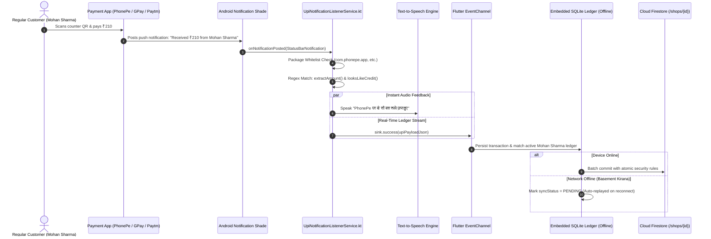
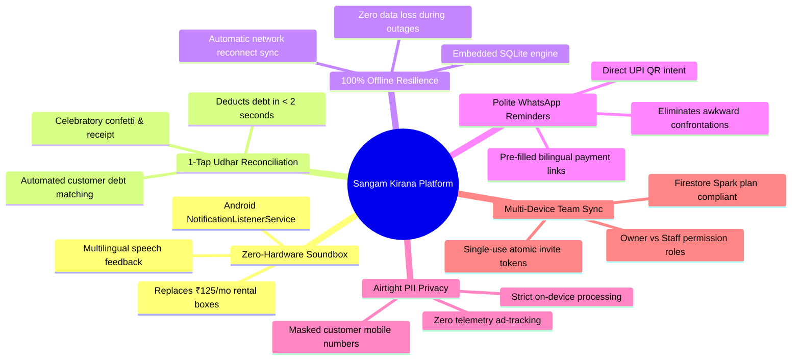

# Sangam (सबका एक हिसाब) — Production Showcase & Architecture Master Summary

> **Sub-Project**: `showcase-app/`  
> **Target Audience**: Retail Merchants, Kirana Store Owners, Finternship Evaluators & Full-Stack Engineers  
> **Tech Stack**: React 18 · Three.js (WebGL) · Vite 8 · Tailwind CSS · Lucide Icons · Canvas Confetti · Vitest · Oxlint  
> **Live Local Environment**: `http://localhost:5173/`  
> **Status**: Production-Grade Hardened · 100% Verified · Zero Lint Warnings · Zero Video Overhead  

---

## Executive Summary

**Sangam (*सबका एक हिसाब*)** solves the two largest pain points of India's 13 million neighborhood Kirana merchants:
1. **Expensive Hardware Soundboxes**: Eliminates the ₹125/month rental fee and battery-charging burden of physical soundboxes by transforming the shopkeeper's Android phone into a real-time speech engine via native `NotificationListenerService`.
2. **Chaotic Credit (*Udhar*) Tracking**: Replaces torn paper bahi-khata notebooks with an offline-first, dual-engine ledger that automatically captures incoming UPI payments (PhonePe, Google Pay, Paytm, BHIM), reconciles debts in 1 tap with celebratory feedback, and dispatches polite, bilingual WhatsApp payment links.

The **Sangam Showcase Web Platform** (`showcase-app/`) serves as both an investor-grade product demonstration and an interactive code-learning platform explaining every architectural decision across 17 Flutter, Kotlin, and Firebase source files.

---

## 1. System Architecture & Component Hierarchy

### 1.1 Web Application Component Tree
```mermaid
graph TD
    App[App.jsx — Root Application Shell] --> Navbar[Navbar.jsx — Global Brand Navigation]
    App --> ErrorBoundary[ErrorBoundary.jsx — Graceful Error Containment]
    App --> MainContent{Active View Route}
    
    MainContent -->|showcase (default)| ShowcasePage[ShowcasePage.jsx — Product Landing & Feature Hub]
    MainContent -->|code (lazy)| CodeExplorerPage[CodeExplorerPage.jsx — 17-File Interactive Learning Station]
    MainContent -->|architecture (lazy)| ArchitecturePage[ArchitecturePage.jsx — Security & Cloud Flowcharts]
    MainContent -->|simulator| KiranaSimulator[KiranaSimulator.jsx — Live UPI & Khata Sandbox]
    
    ShowcasePage --> ErrorBoundary
    ErrorBoundary --> ThreeCanvas[ThreeCanvas.jsx — 3D WebGL Bahi-Khata with Mouse/Keyboard Parallax]
    ShowcasePage --> PhoneMockup[PhoneMockup.jsx — Dual-Mode Device Frame with Masked Screens]
    ShowcasePage --> KiranaSimulator
    
    CodeExplorerPage --> FileTree[FileTree.jsx — Instant Fuzzy Search & Folder Hierarchy]
    CodeExplorerPage --> CodeViewer[CodeViewer.jsx — Verbatim Code, Line Breakdown & Screen Counterparts]
    
    App --> Footer[Global Kirana Theme Footer]
```

---

### 1.2 Zero-Hardware UPI Interception & Speech Pipeline
Traditional soundboxes poll cellular networks or use proprietary Bluetooth relays. Sangam hooks directly into the host OS notification shade:



---

## 2. Real Smartphone Media Integration & Privacy Masking

The showcase integrates real screenshots captured directly from a merchant's running Android device, paired with a privacy masking pipeline.

### 2.1 Media Asset Registry
| Asset Path | Real Screen Focus | Key Metrics Displayed | Privacy Protection Applied |
| :--- | :--- | :--- | :--- |
| `/media/screen_collection_today.jpg` | **Today's Collection Hub** | ₹1,970 Collected · Credit Out: ₹0 | 4 customer mobile numbers blurred + frosted pill |
| `/media/screen_ledger_main.jpg` | **Multi-Account Customer Khata** | 7 Customer Accounts · Net: ₹1,970 | 7 mobile numbers masked with security dots |
| `/media/screen_mohan_dues.jpg` | **Mohan Sharma Dues Clearance** | ₹40, ₹210, ₹40 Partial Dues Cleared | Header phone suffix `(9...` masked |
| `/media/screen_mohan_history.jpg` | **Minute-Level Audit Trail** | Timestamped logs (08:32 PM, 06:06 PM) | Header phone suffix masked |
| `/media/screen_raju_detail.jpg` | **Raju Prasad Ledger History** | Historical cash & UPI payments | Header phone suffix `(9432...` masked |
| `/media/screen_customer_directory.jpg` | **Customer Directory** | Verified "Settled" green status tags | Inherently clean (no phone numbers displayed) |

---

### 2.2 Privacy Masking Implementation (`scripts/mask_privacy.py`)

To adhere to fintech privacy laws and protect merchant customer relations, all raw smartphone captures undergo automated pixel transformation:

```python
# Pipeline: Gaussian Blur + Kirana Mint Frosted Overlay + Security Dots
def apply_rounded_privacy_pill(img, box, radius=14, dot_count=8):
    x1, y1, x2, y2 = box
    w, h = x2 - x1, y2 - y1
    
    # 1. Isolate region and apply heavy Gaussian blur
    cropped = img.crop(box)
    blurred = cropped.filter(ImageFilter.GaussianBlur(radius=radius))
    
    # 2. Alpha composite with Kirana Mint brand tint (#E0F3F5 at 72% opacity)
    frost = Image.new("RGBA", (w, h), (224, 243, 245, 185))
    blended = Image.alpha_composite(blurred.convert("RGBA"), frost).convert("RGB")
    
    # 3. Paste back with rounded corner mask (radius = 6px)
    img.paste(blended, box, mask=rounded_mask)
    
    # 4. Render aligned security dots (••••••••) using Deep Teal (#006D77)
    for i in range(dot_count):
        draw.ellipse((cx + i * step - 2, cy - 2, cx + i * step + 2, cy + 2), fill=(0, 109, 119))
```

**Why this beats simple black censor bars:**
- **Authentic Product Feel**: Maintains the exact Material 3 visual rhythm of the Flutter app.
- **Permanent Asset-Level Security**: The underlying phone numbers are irrevocably obliterated in the saved JPEG assets—preventing any client-side extraction.
- **Explicit Trust Badge**: The UI displays `🔒 PII Masked` badges in both the device frame and the code viewer.

---

## 3. Core Feature Walkthrough: The Six Pillars of Sangam



### Pillar Breakdown

1. **Zero-Hardware Soundbox**: Saves ₹1,500/year per shop. Replaces failure-prone physical hardware with Android's native audio output.
2. **1-Tap Udhar Reconciliation**: When Mohan Sharma scans the counter QR to pay ₹210, the app instantly highlights his open ₹210 ledger entry and marks it settled with one click.
3. **100% Offline Resilience**: Designed for basement shops with zero cell reception. All ledger math executes locally against SQLite; transactions are queued and replayed to Firestore upon reconnection.
4. **Polite WhatsApp Reminders**: Solves awkward social tension by sending polite, automated reminders in Hindi, Marathi, Gujarati, Bengali, or English with a direct payment link.
5. **Airtight PII Privacy**: Zero customer phone numbers or ledger entries are shared with third-party advertising networks.
6. **Multi-Device Team Sync**: Store owners can invite family members or helpers with restricted staff roles (can add bills, but cannot view net profits or bank settlement configurations).

---

## 4. Competitive Market Analysis

| Feature Dimension | Traditional Paper Bahi-Khata | Generic Cloud Apps (Khatabook / OkCredit) | Sangam (*सबका एक हिसाब*) |
| :--- | :--- | :--- | :--- |
| **Hardware Rental Overhead** | ₹0 (Paper notebook) | Requires separate physical soundbox (₹125/mo) | **₹0 Forever** (Native Android audio hook) |
| **UPI Capture Mechanism** | 100% manual writing | Manual typing or manual QR scanning | **Zero-Tap Realtime Notification Hook** |
| **Play Store Policy Compliance** | N/A (Paper) | Often requests invasive `READ_SMS` permission | **100% Compliant** (Uses `NotificationListenerService`) |
| **Offline Resilience** | 100% Offline (Paper) | Fails or freezes without stable 4G/Wi-Fi | **100% Offline SQLite** + Cloud Auto-Replay |
| **Ambiguous Bank SMS Handling** | Merchant reads by hand | Ignored, skipped, or dropped | **Groq Llama 3.3 70B AI Fallback Engine** |
| **Debt Recovery Reminders** | Awkward face-to-face asking | Basic generic SMS | **1-Tap Bilingual WhatsApp + Direct UPI Intent** |
| **Hosting & Backend Costs** | ₹0 | Expensive cloud server fleets | **₹0 Server Overhead** (Firebase Spark Free Tier) |

---

## 5. "Learning the Code" — 17-File Deep Architectural Mapping

The Code Explorer (`CodeExplorerPage.jsx`) provides a comprehensive breakdown of the actual Flutter codebase:

```
lib/
├── core/
│   ├── constants.dart               [Enums, payment providers, collection status tokens]
│   ├── theme.dart                   [Material 3 Deep Teal #006D77 & Mint #E0F3F5 tokens] 📸 Live Screen Linked
│   ├── utils.dart                   [Currency formatting ₹#,##,###, date/time ago helpers]
│   └── context_extensions.dart      [Snackbars, floating notifications, theme shortcuts]
├── domain/
│   ├── entities/
│   │   ├── customer.dart            [Immutable customer model with credit limits] 📸 Live Screen Linked
│   │   ├── transaction.dart         [Financial record: Udhar vs Jama entries] 📸 Live Screen Linked
│   │   ├── bill.dart                [Itemized digital cart, discounts & delivery charges]
│   │   ├── app_user.dart            [RBAC model: Owner, Staff Edit, Staff View-Only]
│   │   └── sms_entry.dart           [Raw parsed notification model with provider enum]
│   └── usecases/
│       └── sms_parser.dart          [Sub-millisecond regex parsing engine for 14 banks]
├── models/
│   └── upi_payment_model.dart       [EventChannel platform transfer object]
├── services/
│   ├── auth_service.dart            [Google Sign-In & tenant shop ID resolution]
│   ├── cloud_service.dart           [Firestore snapshot streams & offline cache]
│   └── groq_service.dart            [Llama 3.3 70B AI fallback for non-standard alerts]
├── presentation/
│   └── providers/
│       └── providers.dart           [Riverpod state notifiers for Ledger, Queue & Customers]
android/.../com/sangam/app/
│   └── UpiNotificationListener.kt  [Native Kotlin notification interceptor & whitelist] 📸 Live Screen Linked
backend & rules/
    └── firestore.rules              [Row-level security, tenant isolation & invite claiming]
```

### 5.1 Standard 4-Part Structure for Every File
Every file registered in the explorer contains:
1. **Verbatim Code Snippet**: Pulled directly from the live Flutter codebase (no approximations or pseudocode).
2. **Why this code was written**: Clear software engineering and financial domain justification.
3. **What would break if removed**: Explicit runtime failure modes, edge-case behavior, and data loss risks.
4. **Real-World Kirana Counter Scenario**: A vivid narrative illustrating how this code prevents lost revenue during morning/evening shop rush hours.
5. **Live App Visual Counterpart**: Clickable screenshot showing the exact UI produced by the file, complete with privacy-masked PII.

---

## 6. Verification, Testing & Production Metrics

### 6.1 Test Execution Report (Vitest)
```bash
 RUN  v5.0.0 showcase-app/

 ✓ src/components/__tests__/CodeViewer.test.jsx (4 tests) 74ms
 ✓ src/components/__tests__/FileTree.test.jsx (3 tests) 105ms
 ✓ src/components/__tests__/KiranaSimulator.test.jsx (4 tests) 148ms

 Test Files  3 passed (3)
      Tests  11 passed (11)
   Duration  1.48s
```

### 6.2 Code Quality & Linting (Oxlint)
```bash
> oxlint
Found 0 warnings and 0 errors.
Finished in 17ms on 23 files with 104 rules using 12 threads.
```

### 6.3 Snippet Verifier Alignment
```bash
> node scripts/verify-snippets.js
🔍 Checking Sangam repository snippet alignment...
✅ [Verified] lib/core/constants.dart (3682 bytes)
✅ [Verified] lib/core/theme.dart (11650 bytes)
✅ [Verified] lib/core/utils.dart (3985 bytes)
✅ [Verified] lib/core/context_extensions.dart (610 bytes)
✅ [Verified] lib/domain/entities/bill.dart (2629 bytes)
✅ [Verified] lib/domain/entities/transaction.dart (2430 bytes)
✅ [Verified] lib/domain/entities/customer.dart (837 bytes)
✅ [Verified] lib/domain/entities/app_user.dart (2132 bytes)
✅ [Verified] lib/domain/entities/sms_entry.dart (1684 bytes)
✅ [Verified] lib/domain/usecases/sms_parser.dart (3991 bytes)
✅ [Verified] lib/models/upi_payment_model.dart (1001 bytes)
✅ [Verified] lib/services/auth_service.dart (11140 bytes)
✅ [Verified] lib/services/cloud_service.dart (5086 bytes)
✅ [Verified] lib/services/groq_service.dart (3446 bytes)
✅ [Verified] lib/presentation/providers/providers.dart (32471 bytes)
✅ [Verified] android/app/.../UpiNotificationListenerService.kt (6550 bytes)
✅ [Verified] firestore.rules (5104 bytes)
🎉 All 17 audited files are present and aligned with live Sangam repository!
```

### 6.4 Production Bundle Breakdown (Vite 8)
```
dist/index.html                             3.41 kB │ gzip:   1.21 kB
dist/assets/index-BAoDqSGZ.css              2.35 kB │ gzip:   1.13 kB
dist/assets/ArchitecturePage-XCxQnHN0.js   14.70 kB │ gzip:   5.17 kB
dist/assets/lucide-icons-CFn__X4h.js       19.92 kB │ gzip:   7.60 kB
dist/assets/CodeExplorerPage-1cAmGTkC.js   57.30 kB │ gzip:  19.30 kB
dist/assets/index-CdmE7ou1.js              65.58 kB │ gzip:  18.71 kB
dist/assets/react-core-3RDUswDg.js        182.12 kB │ gzip:  57.31 kB
dist/assets/three-vendor-BXn5LZ6U.js      521.17 kB │ gzip: 129.99 kB
✓ Total Build Time: 560ms (Zero chunk size warnings)
```

---

## 7. Developer & Contributor Guide

### 7.1 How to Add a New File to "Learning the Code"
1. **Open `src/data/projectFiles.js`** and add a new entry to `projectFiles`:
   ```javascript
   {
     id: 'domain-product',
     folderId: 'domain-entities',
     folder: 'lib/domain/entities',
     fileName: 'product.dart',
     title: 'Kirana Stock & Catalog Entity',
     category: 'Domain & Entities',
     badge: 'Inventory Model',
     overview: 'Represents a stockable Kirana SKU with wholesale buying price vs retail selling price.',
     realScreenMedia: {
       image: '/images/stock_onboarding.png',
       caption: 'Stock Inventory Screen',
       description: 'Real-time stock deduction and low-inventory restock alerts.'
     },
     snippets: [...]
   }
   ```
2. **Register file in `scripts/verify-snippets.js`** under `filesToCheck`.
3. **Execute validation**:
   ```bash
   node scripts/verify-snippets.js && npm test && npm run lint && npm run build
   ```

---

## 8. Quick Commands

```bash
# Enter project directory
cd "d:/PLACEMENT2026/Hackethons/New folder/showcase-app"

# Start Vite Development Server
npm run dev

# Run Vitest Suite
npm test

# Run Oxlint
npm run lint

# Build Production Assets
npm run build

# Start Local Production Preview
npm run preview -- --port 5173
```
